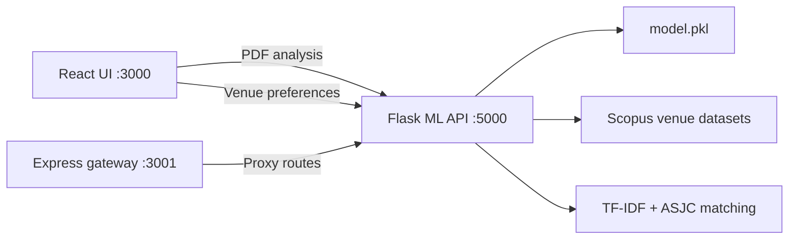

# ScholarVenue

### Research-paper quality analysis and publication-venue recommendation

[](https://www.python.org/)
[](https://react.dev/)
[](https://nodejs.org/)
[](https://flask.palletsprojects.com/)
[](https://scikit-learn.org/)
[](#project-status)

**ScholarVenue** helps researchers make a more informed first submission decision. Upload a paper PDF, receive a writing-quality assessment and summary, inspect similar venues, and generate a ranked shortlist of journals or conferences using subject coverage and publication preferences.

> Built as a research and coursework project by a four-member team at Vidyalankar Institute of Technology for Probabilistic Graphical Models and Recommendation Systems.

## Why ScholarVenue?

Selecting a publication venue is a cold-start recommendation problem: early-career researchers often have no submission history, while publisher-specific finders only cover one catalogue. ScholarVenue combines paper content, venue metadata, subject classifications, and author preferences to produce an explainable shortlist instead of a black-box title match.

## What it does

| Capability | Description |
| --- | --- |
| **PDF analysis** | Extracts text from an uploaded paper with PyMuPDF. |
| **Quality scoring** | Predicts a writing-quality score from 0–10 with a trained Random Forest model. |
| **Writing feedback** | Flags actionable issues such as short papers, sentence structure, repetition, missing conclusions, and sparse citations. |
| **Domain detection** | Infers a research area from paper keywords and maps it to Scopus ASJC subjects. |
| **Venue recommendation** | Ranks up to 10 venues with match scores and human-readable reasons. |
| **Preference filtering** | Supports venue type, open access, Medline indexing, coverage year, discontinued venues, publisher, and indexing preferences. |
| **Venue intelligence** | Uses active status, coverage range, language, publisher, Medline status, source type, and subject coverage. |
| **Similar venues** | Uses TF-IDF and cosine similarity to find related venue titles. |

## How the recommendation works

1. **Build a paper profile** from extracted text, detected topics, and quality signals.
2. **Map topics to ASJC subjects** such as Computer Science, Medicine, Engineering, Physics, and Social Sciences.
3. **Score candidate venues** using subject match, venue quality, paper–venue fit, and publisher profile.
4. **Apply preferences as soft constraints** so the user can explore trade-offs rather than losing every near-match.
5. **Explain each result** with matched subjects, active status, open-access status, coverage years, publisher, and a generated reason.

### Scoring model

| Component | Weight | Examples |
| --- | ---: | --- |
| Subject match | 35% | ASJC subject alignment and cross-disciplinary coverage |
| Venue quality | 25% | Active status, coverage history, Medline and related-title signals |
| Paper–venue fit | 25% | Language, venue type, access preference, and timeline fit |
| Publisher profile | 15% | Publisher profile, source type, and access availability |

## Architecture



### Repository layout

```text
.
├── app.py                         # Flask ML and recommendation API
├── recommender_enhanced_v2.py     # ASJC-aware scoring engine
├── recommender_enhanced.py        # Alternative recommender implementation
├── model.pkl                      # Trained paper-quality model
├── datasets/                      # Venue metadata and processed source lists
├── backend/
│   ├── server.js                  # Express gateway
│   └── routes/recommend.js        # Recommendation proxy route
├── frontend/
│   └── src/                       # React application and UI components
└── docs/                          # Data and implementation notes
```

## Run locally

### Prerequisites

- Python 3.10 or newer
- Node.js 18 or newer
- npm

### 1. Start the Flask API

```powershell
cd research-paper-venue-recommender-main
python -m pip install -r requirements.txt
python app.py
```

The API starts at `http://localhost:5000`.

### 2. Start the Express gateway

```powershell
cd research-paper-venue-recommender-main/backend
npm install
node server.js
```

The gateway starts at `http://localhost:3001`.

### 3. Start the React frontend

```powershell
cd research-paper-venue-recommender-main/frontend
npm install
npm start
```

Open `http://localhost:3000`.

### Service health check

```powershell
Invoke-WebRequest http://localhost:5000/health
```

Expected response includes:

```json
{
  "status": "ok",
  "model_loaded": true,
  "venue_db_loaded": true
}
```

## API reference

### `GET /health`

Returns model and venue-database readiness.

### `POST /predict`

Multipart upload with a `file` field containing a PDF:

```powershell
curl.exe -X POST http://localhost:5000/predict `
  -F "file=@paper.pdf"
```

Returns a quality score, extracted summary, recommendations, similar venues, paper features, and domain statistics.

### `POST /recommend`

JSON request:

```json
{
  "paper_text": "A research paper abstract and supporting text of at least 50 characters.",
  "paper_score": 7.8,
  "paper_topic": "machine learning for document classification",
  "venue_type": "any",
  "indexing": ["Any"],
  "fee_pref": "Any",
  "acceptance": "Any",
  "open_access_only": false,
  "exclude_discontinued": true,
  "medline_only": false,
  "min_coverage_year": 2010,
  "selected_subjects": []
}
```

The response contains up to 10 venues with match scores, matched ASJC subjects, metadata, and explanations.

## Evaluation snapshot

In an internal evaluation using 100 recent arXiv abstracts across 10 fields:

| Metric | ScholarVenue | TF-IDF title baseline |
| --- | ---: | ---: |
| Hit rate@10 | **82%** | 25% |
| Precision@10 | **46.7%** | 7% |

These figures are project-level results, not a claim of peer-reviewed benchmark performance. The next evaluation improvements are stronger domain detection, calibrated scores, broader multidisciplinary handling, and a fixed Medline normalization rule.

## Dataset notes

The recommender uses the included Scopus source-title exports:

- `datasets/ext_venues_enhanced.csv` — full venue metadata
- `datasets/ext_venues_active.csv` — active-venue subset
- `datasets/ext_venues_full.csv` — full processed source list
- `datasets/ext_venues_metadata.json` — dataset metadata

The repository includes derived data for reproducibility. Check the source-data terms and attribution requirements before redistributing or deploying the datasets commercially.

## Project status

ScholarVenue is an educational/research prototype. It is intended to support venue discovery, not replace author judgment, journal author guidelines, editorial decisions, or institutional research-integrity review. Always verify scope, indexing, fees, review timelines, and current submission requirements directly with the venue.

## Roadmap

- [ ] Replace substring keyword matching with token-aware and embedding-assisted domain detection.
- [ ] Normalize Medline and indexing values across source-data variants.
- [ ] Add calibrated recommendation confidence and stronger offline evaluation.
- [ ] Move API URLs to environment-based configuration for deployment.
- [ ] Add automated backend, frontend, and end-to-end tests.
- [ ] Add containerized deployment for reproducible demos.

## Contributing

Issues and pull requests are welcome. For changes to recommendation logic, please include:

1. The user-facing behavior being changed.
2. The data fields or scoring weights affected.
3. A reproducible example or test case.
4. Any impact on recommendation quality, latency, or compatibility.

## Acknowledgements

- Scopus source-title metadata used by the included dataset exports.
- Flask, React, Express, pandas, PyMuPDF, NumPy, and scikit-learn.
- The open-source research and developer communities whose tools make this prototype possible.
